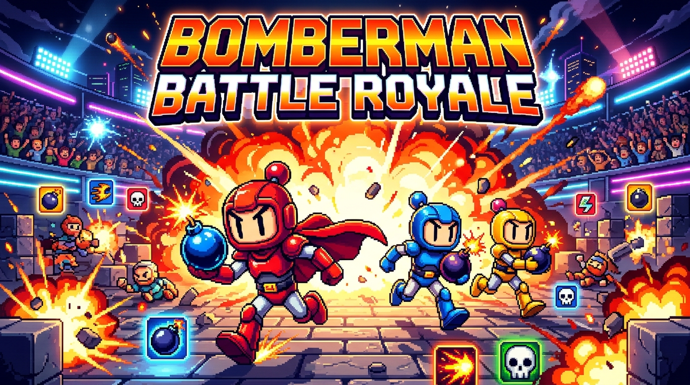

# 💣 Bomberman Battle Royale Web Multiplayer

> Jogo web multiplayer em tempo real inspirado no clássico Bomberman com mecânica de Battle Royale (Sudden Death), 3 arenas dinâmicas, inteligência artificial autônoma para bots e gráficos em Pixel Art 16-bit.



---

## 🌟 Características

- **Jogabilidade Clássica e Precisa**:
  - Grid de 15x13 células com colisão suave e assistência de curvas (*corner sliding*).
  - Temporizadores de bomba, fusível pulsante e explosões em cruz ortogonal.
  - Detonação em cadeia instantânea quando o fogo atinge bombas vizinhas.
- **Mecânica Battle Royale (Sudden Death)**:
  - Nos 60 segundos finais, a sirene de emergência dispara e blocos gigantes caem do céu em espiral pelas bordas do mapa, esmagando o campo e forçando o combate no centro.
- **3 Arenas Temáticas Exclusivas**:
  - 🌿 **Green Meadow**: Layout clássico equilibrado.
  - 🌋 **Magma Cavern**: Barris de TNT voláteis que explodem em cadeia em 360°.
  - ⚡ **Cyber Grid**: Esteiras rolantes aceleradoras de bombas e portais de teletransporte quântico.
- **Sistema Completo de Power-ups**:
  - 💣 **Bomb Up**: +1 capacidade de bombas simultâneas.
  - 🔥 **Fire Up**: +1 alcance do raio de fogo.
  - 👟 **Speed Up**: Aumento de velocidade de movimento.
  - 🥾 **Bomb Kick**: Permite chutar bombas pelo cenário.
  - 🛡️ **Shield**: Absorve o impacto de uma explosão.
  - 💀 **Skull**: Maldição temporária caótica.
- **Multiplayer em Tempo Real & Bots Inteligentes**:
  - Servidor autoritativo Node.js + WebSockets (`Socket.io`) rodando a 30 ticks por segundo.
  - Criação de salas públicas ou privadas com código único.
  - Modo solo com 1 clique ("Partida Rápida") preenchendo vagas com bots de IA tática.
- **Áudio Procedural & Efeitos Visuais**:
  - Efeitos sonoros sintetizados em tempo real via Web Audio API (sem dependência de arquivos externos).
  - Screen shake, fragmentos de blocos voando e partículas de explosão.

---

## 🎮 Controles

| Ação | Teclado | Dispositivos Touch |
|---|---|---|
| Mover-se | `W, A, S, D` ou `Setas` | D-Pad virtual na tela |
| Colocar Bomba | `Barra de Espaço` | Botão vermelho 💣 |

---

## 🚀 Como Executar Localmente

### Pré-requisitos
- [Node.js](https://nodejs.org/) v18 ou superior.
- `npm` ou `pnpm` / `yarn`.

### Instalação
```bash
# Clone o repositório
git clone https://github.com/diegolindolfo/bomberman-battle-royale.git
cd bomberman-battle-royale

# Instale as dependências
npm install
```

### Executar em Desenvolvimento
```bash
npm run dev
```
Acesse no seu navegador: `http://localhost:3000`

### Build para Produção
```bash
npm run build
npm start
```

### Rodar Testes Automatizados
```bash
npm test
```

---

## 🛠️ Tecnologias Utilizadas

- **Frontend**: HTML5 Canvas 2D, TypeScript, Vite.
- **Backend**: Node.js, Express, Socket.io (WebSockets).
- **Áudio**: Web Audio API (Síntese sonora procedural).
- **Testes**: Node.js Test Runner nativo + tsx.

---

Desenvolvido com dedicação para os fãs do clássico Bomberman! 👑
